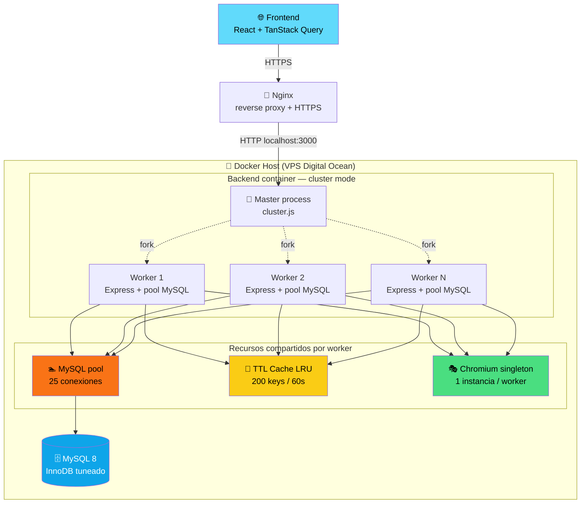
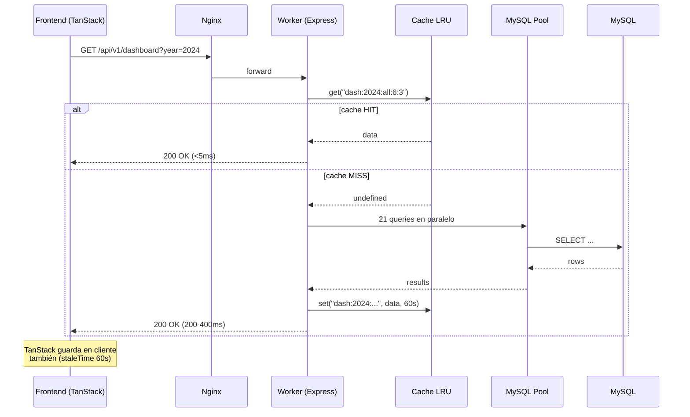
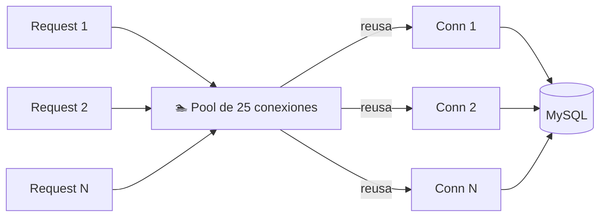
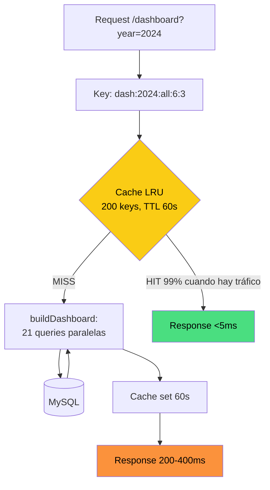
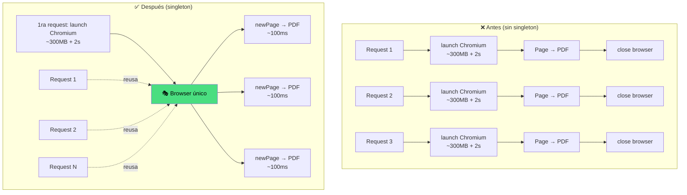
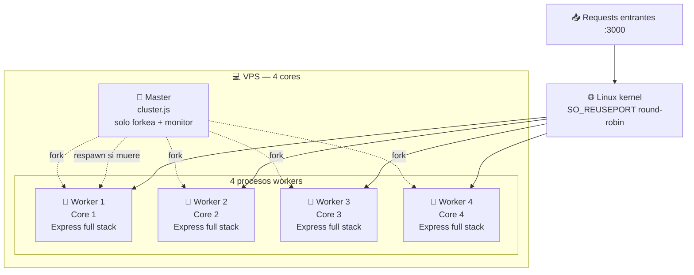
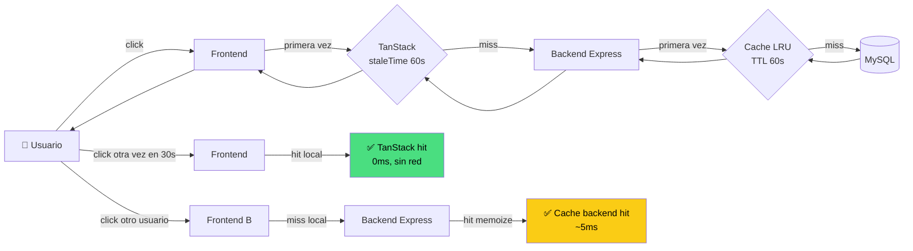
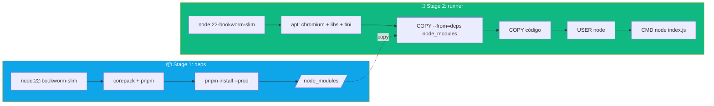
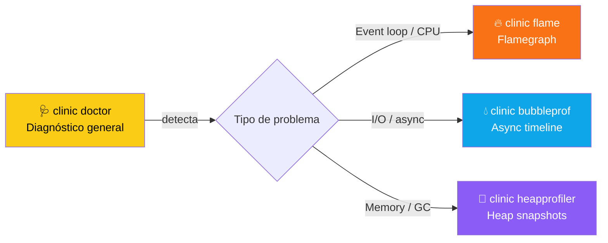
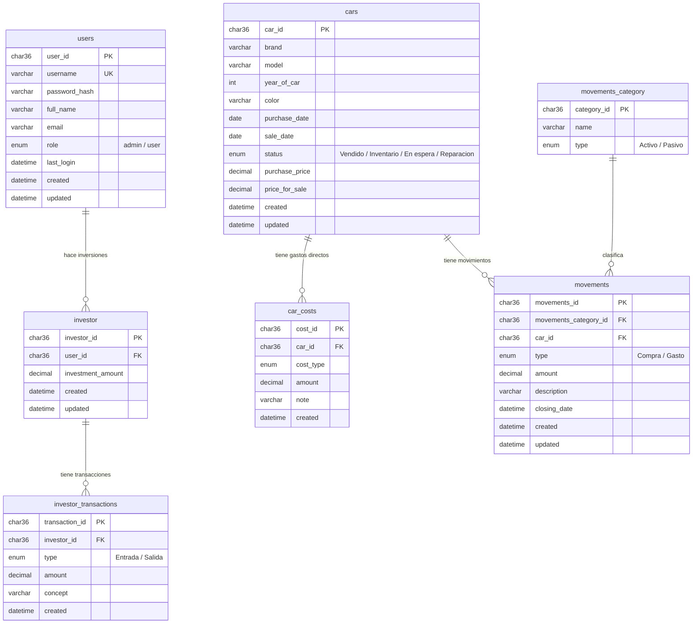

# 🚗 Backend Bazar Autos

> Sistema backend para administrar un bazar de autos: inventario, ventas, inversionistas, gastos, dashboards y reportes (PDF/XLSX/CSV).
>
> **Stack:** Node.js 22 · Express 5 · MySQL 8 · Puppeteer · ExcelJS · Docker · pnpm
>
> Última actualización: Mayo 2026

---

## 📑 Tabla de contenidos

- [🎯 Resumen](#-resumen)
- [🏗️ Arquitectura general](#️-arquitectura-general)
- [⚡ Optimización del backend — la historia](#-optimización-del-backend--la-historia)
  - [1. 🏊 Connection pooling](#1--connection-pooling)
  - [2. 🧠 Cache en memoria con TTL](#2--cache-en-memoria-con-ttl)
  - [3. 🎭 Puppeteer browser singleton](#3--puppeteer-browser-singleton)
  - [4. 🚀 Cluster mode (multi-core)](#4--cluster-mode-multi-core)
  - [5. 🗜️ Compression (gzip)](#5-️-compression-gzip)
  - [6. 📊 Monitor real-time](#6--monitor-real-time)
- [🧩 Cache en dos capas — TanStack + Backend](#-cache-en-dos-capas--tanstack--backend)
- [🐳 Despliegue con Docker](#-despliegue-con-docker)
- [💻 Desarrollo local](#-desarrollo-local)
- [🧪 Load testing](#-load-testing)
- [🩺 Profiling (clinic.js)](#-profiling-clinicjs)
- [📡 Endpoints](#-endpoints)
- [🗄️ Base de datos](#️-base-de-datos)

---

## 🎯 Resumen

Este backend gestiona el ciclo completo de un bazar de autos:

| Módulo | Descripción |
|--------|-------------|
| 🚗 **Autos** | Inventario, estado, costos asociados |
| 💸 **Movimientos** | Entradas/salidas de dinero generales |
| 🔧 **Costos por vehículo** | Gastos directos sobre cada auto |
| 👥 **Inversionistas** | Capital aportado + transacciones |
| 📊 **Dashboard** | 21 métricas (KPIs + charts) en una request |
| 📑 **Reportes** | Export PDF / XLSX / CSV con datos agrupados |
| 🔐 **Auth** | JWT + roles (admin/user) |

Lo que hace **interesante** este repo no es el CRUD — es el trabajo de **optimización del backend** para que aguante carga real (~10 usuarios concurrentes) en un VPS modesto sin tirarse abajo.

---

## 🏗️ Arquitectura general



**Flujo de una request típica (dashboard):**



---

## ⚡ Optimización del backend — la historia

Node.js es **single-threaded**. No puedes reservar bits de memoria como en C/C# o paralelizar como en Java fácilmente. La optimización en Node se trata de:

1. **No bloquear el event loop** (operaciones síncronas pesadas son la muerte)
2. **Reusar recursos caros** (conexiones DB, procesos Chromium)
3. **Cachear lo que puedas** (evitar trabajo repetido)
4. **Aprovechar múltiples cores** (cluster / workers)
5. **Medir todo** (sin métricas optimizas a ciegas)

Este backend pasó por **6 optimizaciones clave**.

---

### 1. 🏊 Connection pooling

**Problema:** crear/cerrar conexión MySQL por request es caro (~50-150ms de TCP + auth). Si no se manejan bien, también agotan rápido.

**Solución:** pool de 25 conexiones reusables (`src/lib/db.js`).



**Tuning en `src/config/config.js`:**

```js
db: {
  connectionLimit: 25,      // sube si "Too many connections"
  maxIdle: 10,              // mantén warm pero sin desperdiciar
  idleTimeout: 60000,       // cierra después de 60s ocioso
  enableKeepAlive: true,    // TCP keep-alive evita reconexión
}
```

**Tamaño del pool:** regla de oro = `(cores_db × 2) + spindle_count`. Para MySQL en VPS de 1 core sin SSD pegado a la maquinaria = 3. Pero como cada request del dashboard hace 21 queries concurrentes, necesitamos **25 mínimo** para 1 usuario haciendo dashboard sin contención.

⚠️ **Cuidado:** `connectionLimit` × `workers cluster` no debe pasar el `max_connections` de MySQL. Si tienes 4 workers × 25 = 100 conexiones — el `--max-connections=150` en docker-compose deja margen.

---

### 2. 🧠 Cache en memoria con TTL

**Problema:** el endpoint `/dashboard` ejecuta **21 queries en paralelo**. Cada una tarda 5-30ms. Total: 200-400ms. Si 10 usuarios pegan al mismo tiempo = 210 queries simultáneas pegándole al pool y a MySQL.

**Solución:** cache LRU con TTL de 60 segundos (`src/lib/cache.js`).



**El patrón `memoize`:**

```js
// src/services/dashboard-services.js
const cacheKey = `dash:${currentYear}:${currentMonth}:${yearsRange}:${topLimit}`;

return memoize(
  cacheKey,
  () => buildDashboard(currentYear, currentMonth, yearsRange, topLimit),
  60_000, // TTL 60s
);
```

**¿Por qué no Redis?** Para 1 instancia + datos no críticos, in-memory es:
- ⚡ Cero latencia de red (Redis local ~1ms, remoto ~5-50ms)
- 💰 Cero infra extra
- 🚫 Cero punto de falla nuevo

**Cuándo migrar a Redis:** cuando escales horizontalmente (varias instancias del backend detrás de load balancer). Cada instancia tendría su propio cache y se desincronizan.

---

### 3. 🎭 Puppeteer browser singleton

**El monstruo:** Puppeteer lanza **Chromium** para generar PDFs. Cada `puppeteer.launch()`:
- 🐌 Tarda **1-3 segundos** (descomprimir, arrancar V8, crear sandbox)
- 🐘 Consume **~300MB de RAM**

Si 10 usuarios piden PDF al mismo tiempo sin optimizar = **3GB de RAM + 30 segundos acumulados de launch**.

**Solución:** un solo browser para todo el proceso, se crean **pages** por request (`src/lib/browser.js`).



**Implementación:**

```js
// src/lib/browser.js
let browserPromise = null;

export const getBrowser = () => {
  if (!browserPromise) {
    browserPromise = launchBrowser();
  }
  return browserPromise;
};

// Si el browser muere, se relanza en próxima request
browser.on("disconnected", () => { browserPromise = null; });

// Cierre limpio en SIGTERM/SIGINT
process.once("SIGINT", () => closeBrowser());
process.once("SIGTERM", () => closeBrowser());
```

**Flags clave del browser:**

```js
args: [
  "--no-sandbox",                    // requerido en Docker
  "--disable-dev-shm-usage",         // evita crash por /dev/shm pequeño
  "--disable-gpu",                   // no hay GPU en VPS
  "--no-zygote",                     // un proceso menos
  "--disable-background-timer-throttling",
  "--disable-renderer-backgrounding",
]
```

**Resultado:**

| Métrica | Antes | Después |
|---------|-------|---------|
| Tiempo de generación PDF | 2.5-3s | **~500ms** |
| RAM con 10 PDFs concurrent | ~3GB | **~400MB** |
| CPU spike por request | 80-100% | **20-40%** |

---

### 4. 🚀 Cluster mode (multi-core)

**El problema fundamental de Node:** un proceso = un thread = un core utilizado.

En un VPS de 4 cores, sin cluster, el backend solo aprovecha el **25%** del CPU disponible.

**Solución:** Node `cluster` API forkea un worker por cada CPU. El SO balancea conexiones entrantes entre workers automáticamente (round-robin en Linux).



**Implementación (`cluster.js`):**

```js
import cluster from "node:cluster";
import os from "node:os";

if (cluster.isPrimary) {
  const numCPUs = os.cpus().length;
  for (let i = 0; i < numCPUs; i++) cluster.fork();

  // Auto-respawn si un worker crashea
  cluster.on("exit", () => cluster.fork());
} else {
  import("./index.js"); // Worker = server normal
}
```

**Ganancia esperada:** ~3.5-4x throughput en VPS de 4 cores (no es exactamente 4x por overhead de master + IPC).

⚠️ **Cuidado con el estado en memoria:** el cache LRU es **por worker**. No se comparte. Esto significa:
- 4 workers × 200 keys × 60s = hasta 4x la RAM de cache
- Cache hits se ven solo dentro del mismo worker (round-robin reduce hit rate)

**Si te molesta:** cachea con Redis cuando escales. Para 10 usuarios concurrentes en 4 workers no es problema.

> 🚨 **¿Tienes 1 vCPU?** Cluster mode **no ayuda**. Con 1 core, el master process + 1 worker compiten por el mismo core → overhead puro sin ganancia de throughput. El Dockerfile ya está configurado con `CMD ["node", "index.js"]` para 1 vCPU. Sube a 2 vCPU para activar cluster.

---

### 5. 🗜️ Compression (gzip)

**El problema:** respuestas JSON grandes (dashboard ~50KB, reports JSON puede ser MB) se mandan sin comprimir = más banda + más latencia.

**Solución:** middleware `compression`:

```js
import compression from "compression";
app.use(compression()); // gzip automático
```

**Ganancia:** JSON de 50KB → ~8KB. Banda y latencia reducidos significativamente, especialmente sobre conexiones móviles.

---

### 6. 📊 Monitor real-time

**Sin métricas, optimizas a ciegas.** Monté `express-status-monitor` que da un dashboard en `/status`:

- 📈 CPU usage en tiempo real
- 💾 Memory usage + heap
- ⚙️ Event loop lag (medida real con `event-loop-stats` en Linux)
- ⏱️ Response time (avg, p50, p99)
- 🔥 Requests per second
- 🎨 HTTP status codes distribution
- ❤️ Health checks

```mermaid
graph LR
    App[Express app] --> SM[express-status-monitor]
    SM --> Socket[Socket.io stream]
    Socket --> UI[/status HTML page<br/>Smoothie charts]
    UI --> Browser[👁️ Tú observando]

    style UI fill:#facc15,color:#000
```

**Abrir:** `http://localhost:3000/status` (después de levantar el backend).

⚠️ **En producción:** considera proteger `/status` con auth o IP whitelist. Expone info sensible del proceso.

---

## 🧩 Cache en dos capas — TanStack + Backend

El frontend usa **TanStack Query** que cachea las responses del lado cliente. Combinado con el cache en backend = **doble protección**:



**Beneficio combinado:**

| Escenario | Sin caches | Con TanStack + Backend |
|-----------|-----------|------------------------|
| Mismo usuario, refresh en 30s | 200-400ms + 21 queries | **0ms** (TanStack hit) |
| Usuario B abre dashboard | 200-400ms + 21 queries | **~5ms** (backend hit) |
| Después de 60s (cache expirado) | 200-400ms + 21 queries | 200-400ms + 21 queries |

**Patrón TanStack Query típico:**

```ts
const { data } = useQuery({
  queryKey: ["dashboard", { year, month }],
  queryFn: () => fetch("/api/v1/dashboard?year=...").then(r => r.json()),
  staleTime: 60_000,    // mismo TTL que backend
  gcTime: 5 * 60_000,   // mantén en memoria 5 min
});
```

---

## 🐳 Despliegue con Docker

Multi-stage build optimizado:



**Lo que hace especial este Dockerfile:**

| Optimización | Por qué |
|--------------|---------|
| 🔀 **Multi-stage** | Stage final no tiene pnpm ni cache de build → imagen ~150MB menos |
| 🐧 **tini como PID 1** | Maneja SIGTERM correctamente para procesos Chromium |
| 🛠️ **UV_THREADPOOL_SIZE=4** | Default libuv; con 1 vCPU más threads solo compiten por el mismo core |
| 💾 **--max-old-space-size=300** | Heap Node limitado a 300MB — deja RAM para MySQL (~350MB) y OS (~150MB) |
| 🩺 **HEALTHCHECK** | Docker reinicia el contenedor si la API se cuelga |
| 👤 **USER node** | Nunca correr como root (seguridad) |

**docker-compose.yml — extras de performance (tuneado para 1 vCPU / 1 GB RAM):**

```yaml
api:
  shm_size: "128mb"          # /dev/shm para Chromium (128MB ok para 1-2 PDFs concurrent)
  tmpfs:
    - /tmp:size=64m          # /tmp en RAM (Chromium temp files)
  ulimits:
    nofile:
      soft: 65536            # file descriptors altos
      hard: 65536
  deploy:
    resources:
      limits:
        cpus: "1.0"          # 1 vCPU completo para Node
        memory: 450M         # heap 300MB + Chromium singleton ~150MB

db:
  command:
    - --max-connections=50              # 15 pool Node + overhead = suficiente
    - --innodb-buffer-pool-size=128M    # no más — Node necesita su espacio también
    - --innodb-flush-log-at-trx-commit=2  # más rápido, mínima pérdida en crash
    - --innodb-flush-method=O_DIRECT      # bypass page cache del SO
    - --skip-name-resolve                 # evita DNS lookups
    - --performance-schema=OFF            # ahorra 50-100MB RAM
    - --thread-cache-size=8               # reutiliza threads de conexión
```

**Distribución de RAM con estas configs:**

```
MySQL container  → 400MB límite  (128MB buffer pool + InnoDB overhead)
Node container   → 450MB límite  (300MB heap + Chromium singleton)
OS + Docker      → ~150MB overhead
─────────────────────────────────────────────────────────────────────
Total            → ~1000MB / 1000MB  ← justo, sin OOM
```

> 💡 **Upgrade a 2 vCPU / 2 GB RAM:** activa cluster mode cambiando el `CMD` en Dockerfile a `["node", "cluster.js"]` y ajustando los limits: `cpus: "2.0"`, `memory: 1G`, `innodb-buffer-pool-size=256M`, `DB_POOL_LIMIT=25`.

### Levantar todo

```bash
# 1. Crea .env desde .env.example y llena los valores
cp .env.example .env

# 2. Build + run en background
docker compose up -d --build

# 3. Ver logs
docker compose logs -f api

# 4. Importar dump de datos (una vez)
Get-Content dump.sql | docker exec -i bazar_mysql mysql -u root -p$env:DB_PASS $env:DB_NAME

# 5. Comprobar health
docker compose ps
curl http://localhost:3000/api/v1
```

### Subir cambios sin downtime

```bash
docker compose up -d --build api    # rebuild solo el api
# docker hace rolling restart si tienes replicas
```

### Limpiar

```bash
docker compose down              # detiene + remueve contenedores
docker compose down -v           # ⚠️ también borra volúmenes (datos MySQL!)
```

---

## 💻 Desarrollo local

```bash
# Instalar deps
pnpm install

# Variables de entorno
cp .env.example .env

# Levantar MySQL en Docker (sin el backend)
docker compose up -d db

# Dev mode (nodemon, sin cluster)
pnpm dev

# Producción local (cluster + heap limit)
pnpm start:prod

# Solo cluster sin NODE_ENV
pnpm start:cluster
```

**Scripts útiles:**

| Script | Descripción |
|--------|-------------|
| `pnpm dev` | nodemon + auto-reload |
| `pnpm start` | un solo proceso |
| `pnpm start:cluster` | multi-core local |
| `pnpm start:prod` | producción local (cluster + heap 512MB) |
| `pnpm loadtest:root` | autocannon contra `/` |
| `pnpm loadtest:dashboard` | autocannon contra dashboard |
| `pnpm loadtest:reports` | autocannon contra reports PDF |
| `pnpm perf:doctor` | clinic doctor profiling |
| `pnpm perf:flame` | clinic flamegraph |
| `pnpm format` | biome format |
| `pnpm lint` | biome lint |

---

## 🧪 Load testing

Simula 10 usuarios concurrentes con [autocannon](https://github.com/mcollina/autocannon).

```powershell
# 1. Levanta el backend (modo cluster recomendado)
pnpm start:cluster

# 2. (Opcional) Genera un JWT válido para endpoints protegidos
$env:AUTH_TOKEN = "eyJhbGc..."

# 3. Corre el escenario que quieras
pnpm loadtest:dashboard
pnpm loadtest:reports
```

**Configuración por env:**

```powershell
$env:LOADTEST_CONNECTIONS = "20"
$env:LOADTEST_DURATION = "60"
pnpm loadtest:dashboard
```

**Mientras corre el test:** abre `http://localhost:3000/status` en otro tab para ver el comportamiento en tiempo real.

**Métricas que reporta autocannon:**

```
📊 Resumen:
   Requests totales:     1543
   Requests/seg (avg):   51.43
   Latencia p50:         180 ms
   Latencia p99:         420 ms
   Latencia max:         1024 ms
   Throughput:           212.34 KB/s
   Errores:              0
   Timeouts:             0
   Non-2xx:              0
```

**Qué mirar:**

- 🟢 **p99 < 1000ms** = buena salud
- 🟡 **p99 < 3000ms** = aceptable
- 🔴 **p99 > 3000ms o timeouts** = cuello de botella

---

## 🩺 Profiling (clinic.js)

Clinic es la mejor suite para perfilar Node.js. Tres herramientas:



**Workflow típico:**

```bash
# 1. Instalar clinic globalmente
npm install -g clinic

# 2. Doctor — diagnóstico inicial
pnpm perf:doctor
# (en otra terminal) hits al backend con autocannon
# Ctrl+C → reporte HTML en browser

# 3. Si doctor reporta CPU/Event loop
clinic flame -- node index.js
# Ctrl+C → flamegraph muestra qué funciones consumen más CPU

# 4. Si doctor reporta I/O async
clinic bubbleprof -- node index.js
# Ctrl+C → timeline de operaciones asíncronas
```

**Cómo leer el reporte de doctor:**

| Indicador | Significa |
|-----------|-----------|
| ✅ **Verde** | Salud OK en esa dimensión |
| ⚠️ **Amarillo** | Sospecha de cuello de botella |
| ❌ **Rojo** | Problema confirmado |

Categorías:
- **CPU usage** → ¿estás saturando los cores?
- **Memory usage** → ¿hay leak o crecimiento sin control?
- **Event Loop delay** → ¿operaciones síncronas bloqueando?
- **Active handles** → ¿conexiones / archivos no se cierran?

⚠️ **Truco:** corre clinic en `pnpm dev` (1 proceso). Cluster confunde a clinic porque hay múltiples procesos.

---

## 📡 Endpoints

Todos bajo `/api/v1`. Endpoints protegidos requieren `Authorization: Bearer <jwt>`.

### 🔐 Auth

| Método | Path | Descripción |
|--------|------|-------------|
| POST | `/auth/login` | Login (rate limited: 10 req/15min) |
| POST | `/auth/logout` | Cierra sesión |
| POST | `/auth/refresh` | Refresh token |

### 🚗 Cars

| Método | Path | Descripción |
|--------|------|-------------|
| GET | `/cars` | Lista paginada con filtros |
| GET | `/cars/:id` | Detalle |
| GET | `/cars/models` | Modelos disponibles |
| POST | `/cars` | Crear |
| PATCH | `/cars/:id` | Actualizar |
| DELETE | `/cars/:id` | Eliminar |

### 👥 Investors

| Método | Path | Descripción |
|--------|------|-------------|
| GET | `/investors` | Lista |
| POST | `/investors` | Crear |
| PATCH | `/investors/:id` | Actualizar |

### 💸 Expenses / Movements

| Método | Path | Descripción |
|--------|------|-------------|
| GET | `/expenses` | Lista paginada |
| POST | `/expenses` | Registrar |
| PATCH | `/expenses/:id` | Actualizar |
| DELETE | `/expenses/:id` | Eliminar |

### 📊 Dashboard

| Método | Path | Descripción |
|--------|------|-------------|
| GET | `/dashboard?year=&month=&years_range=&top_limit=` | 21 métricas (KPIs + 8 charts) — **cached 60s** |

### 📑 Reports

| Método | Path | Body | Descripción |
|--------|------|------|-------------|
| POST | `/reports/export` | `{ type, format, date_from, date_to }` | Genera reporte. **Solo admin.** |

- `type`: `sales` · `expenses` · `investments` · `full`
- `format`: `pdf` · `xlsx` · `csv`

### 🩺 Sistema

| Método | Path | Descripción |
|--------|------|-------------|
| GET | `/api/v1` | Health check |
| GET | `/status` | 📊 Monitor real-time (dashboard gráfico) |
| GET | `/api/docs` | Swagger UI |

---

## 🗄️ Base de datos



**Reglas:**

- 🆔 Todas las tablas usan `CHAR(36)` para UUIDs
- 💰 Montos como `DECIMAL(10,2)` para precisión financiera
- 🗑️ Eliminar un auto borra sus `car_costs` y `movements` en cascada
- 📅 `closing_date` en `movements` permite filtrar gastos por período de cierre contable (independiente del `created`)

---

## 🛣️ Roadmap futuro

- [ ] 🔴 Migrar cache a **Redis** cuando escale a múltiples instancias
- [ ] 📊 Exportar métricas a **Prometheus** + Grafana
- [ ] 🚨 Alertas en Sentry para errores en producción
- [ ] 🧪 Tests automatizados con **vitest** + supertest
- [ ] 🔐 Rotación automática de JWT secrets
- [ ] 📦 CDN para assets estáticos (Cloudflare R2)
- [ ] 🌍 i18n para reportes (actualmente solo español)
- [ ] 🤖 Webhooks para integraciones externas

---

## 👥 Autores

- **Erick Gonzalez** — [@muke78](https://github.com/muke78)
- **Osvaldo Cabrera** — [@OsvaldoBC6](https://github.com/OsvaldoBC6)

---

## 📄 Licencia

ISC
