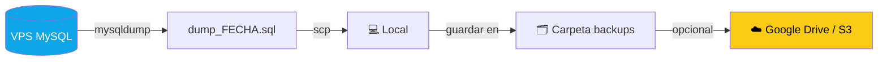

# 🗄️ Guía completa — Dumps de base de datos y seguridad VPS

> Esta guía cubre cómo hacer respaldos de MySQL correctamente, subirlos/bajarlos entre local y Digital Ocean, y qué seguridad básica necesita el VPS.
>
> ⚠️ Leer completo antes de ejecutar cualquier comando con datos reales.

---

## 📑 Tabla de contenidos

- [🔍 ¿Qué backup hace Digital Ocean?](#-qué-backup-hace-digital-ocean)
- [💾 Dump de MySQL — conceptos](#-dump-de-mysql--conceptos)
- [🖥️ Comandos locales (Windows PowerShell)](#️-comandos-locales-windows-powershell)
- [🌐 Comandos en el VPS (Digital Ocean SSH)](#-comandos-en-el-vps-digital-ocean-ssh)
- [⬆️ Subir dump local → VPS](#️-subir-dump-local--vps)
- [⬇️ Bajar dump VPS → local](#️-bajar-dump-vps--local)
- [🔐 Seguridad del VPS](#-seguridad-del-vps)

---

## 🔍 ¿Qué backup hace Digital Ocean?

El backup automático que configuraste **NO es un dump de MySQL**. Es un **snapshot del disco completo** del Droplet (Ubuntu + archivos + Docker + todo).

| | DO Automated Backup | MySQL dump |
|--|---------------------|------------|
| **Qué respalda** | Disco completo del Droplet | Solo la base de datos |
| **Frecuencia** | Semanal (domingo) | Tú decides |
| **Restaurar** | Crea un nuevo Droplet desde la imagen | Importas el archivo .sql |
| **Útil para** | Desastre total (VPS muerto) | Migrar datos, dev local, rollback |
| **Tamaño** | GBs (todo el disco) | MBs (solo datos) |

**Conclusión:** DO backup te salva si el Droplet muere, pero para operación normal (migrar datos, rollback de una mala carga, clonar a local) necesitas dumps de MySQL.

---

## 💾 Dump de MySQL — conceptos

Un dump es un archivo `.sql` con `CREATE TABLE` + `INSERT INTO` de toda la base de datos. Se genera con `mysqldump` y se importa con `mysql`.

**Regla de oro:**
- `schema.sql` → solo estructura (DDL, sin datos) → va a git ✅
- `dump_FECHA.sql` → estructura + datos reales → **NUNCA va a git** ❌ (`.gitignore` lo excluye)

---

## 🖥️ Comandos locales (Windows PowerShell)

El backend local corre en Docker. El contenedor MySQL se llama `bazar_mysql`.

### Generar dump local

```powershell
# Dump completo (estructura + datos)
# Formato: dump_YYYYMMDD_HHMMSS.sql
$fecha = Get-Date -Format "yyyyMMdd_HHmmss"
docker exec bazar_mysql mysqldump -u root -p"TU_ROOT_PASS" bazar_autos | Out-File -Encoding utf8 "dump_$fecha.sql"

# Verificar que no esté vacío
Get-Item "dump_$fecha.sql" | Select-Object Name, Length
```

> ⚠️ Sustituye `TU_ROOT_PASS` con el valor de `MYSQL_ROOT_PASSWORD` en tu `.env`.

### Verificar contenido del dump

```powershell
# Ver primeras líneas (debe mostrar CREATE TABLE, etc.)
Get-Content "dump_20240524_120000.sql" -TotalCount 20
```

### Importar dump local

```powershell
# Importar al contenedor local
Get-Content "dump_20240524_120000.sql" | docker exec -i bazar_mysql mysql -u root -p"TU_ROOT_PASS" bazar_autos
```

### Importar solo schema (sin datos)

```powershell
# Schema limpio (para testing o reset)
Get-Content schema.sql | docker exec -i bazar_mysql mysql -u root -p"TU_ROOT_PASS" bazar_autos
```

### Verificar import exitoso

```powershell
docker exec bazar_mysql mysql -u root -p"TU_ROOT_PASS" bazar_autos -e "
SELECT table_name, table_rows
FROM information_schema.tables
WHERE table_schema = 'bazar_autos'
ORDER BY table_rows DESC;"
```

---

## 🌐 Comandos en el VPS (Digital Ocean SSH)

Conecta al VPS primero:

```bash
ssh deployer@IP_PUBLICA_DO
```

### Generar dump en el VPS

```bash
# En el VPS — genera dump en /home/deployer/
FECHA=$(date +%Y%m%d_%H%M%S)
docker exec bazar_mysql mysqldump -u root -p"TU_ROOT_PASS" bazar_autos > /home/deployer/dump_${FECHA}.sql

# Verificar que no esté vacío
ls -lh /home/deployer/dump_*.sql

# Ver primeras líneas
head -20 /home/deployer/dump_${FECHA}.sql
```

### Importar dump en el VPS

```bash
# En el VPS — importar un dump que ya subiste
docker exec -i bazar_mysql mysql -u root -p"TU_ROOT_PASS" bazar_autos < /home/deployer/dump_import.sql

# Verificar tablas y filas
docker exec bazar_mysql mysql -u root -p"TU_ROOT_PASS" bazar_autos -e "
SELECT table_name, table_rows
FROM information_schema.tables
WHERE table_schema = 'bazar_autos'
ORDER BY table_rows DESC;"
```

### Ver logs del contenedor MySQL

```bash
docker compose logs db --tail=50
```

---

## ⬆️ Subir dump local → VPS

Caso de uso: tienes datos en local que quieres subir a producción.

```powershell
# 1. Generar dump local primero
$fecha = Get-Date -Format "yyyyMMdd_HHmmss"
docker exec bazar_mysql mysqldump -u root -p"TU_ROOT_PASS" bazar_autos | Out-File -Encoding utf8 "dump_$fecha.sql"

# 2. Subir dump al VPS con SCP
scp "dump_$fecha.sql" deployer@IP_PUBLICA_DO:/home/deployer/dump_import.sql

# 3. Conectar al VPS e importar
ssh deployer@IP_PUBLICA_DO "docker exec -i bazar_mysql mysql -u root -pTU_ROOT_PASS bazar_autos < /home/deployer/dump_import.sql"

# 4. Verificar
ssh deployer@IP_PUBLICA_DO "docker exec bazar_mysql mysql -u root -pTU_ROOT_PASS bazar_autos -e 'SELECT COUNT(*) AS cars FROM cars;'"
```

> ✅ Si no tienes `scp` en PowerShell, instala OpenSSH Client en Windows o usa WinSCP.

---

## ⬇️ Bajar dump VPS → local

Caso de uso: bajas los datos de producción para trabajar local o hacer respaldo manual.

```powershell
# 1. Generar dump en el VPS
ssh deployer@IP_PUBLICA_DO "docker exec bazar_mysql mysqldump -u root -pTU_ROOT_PASS bazar_autos > /home/deployer/dump_prod.sql"

# 2. Descargar al local
scp deployer@IP_PUBLICA_DO:/home/deployer/dump_prod.sql .\dump_prod_$(Get-Date -Format 'yyyyMMdd').sql

# 3. Importar local
Get-Content "dump_prod_$(Get-Date -Format 'yyyyMMdd').sql" | docker exec -i bazar_mysql mysql -u root -p"TU_ROOT_PASS" bazar_autos

# 4. (Opcional) Limpiar dump del VPS para no ocupar espacio
ssh deployer@IP_PUBLICA_DO "rm /home/deployer/dump_prod.sql"
```

### Flujo completo recomendado (rutina semanal)



---

## 🔐 Seguridad del VPS

### Lo que ya tienes ✅

- ✅ **Nginx** como reverse proxy (Node no expuesto directo)
- ✅ **DO Firewall** (capa de red gestionada por DigitalOcean)
- ✅ **Usuario `deployer`** (no root para operaciones normales)
- ✅ **MySQL no expuesto** (sin `ports` en docker-compose)
- ✅ **Backups automáticos** semanales del Droplet completo

### Lo que deberías agregar 🔧

#### 1. UFW (firewall local de Ubuntu)

DO Firewall protege a nivel de red, UFW protege a nivel del SO. Doble capa.

```bash
# En el VPS como deployer (con sudo)
sudo ufw default deny incoming
sudo ufw default allow outgoing

# Solo abrir los puertos necesarios
sudo ufw allow 22/tcp       # SSH
sudo ufw allow 80/tcp       # HTTP (Nginx)
sudo ufw allow 443/tcp      # HTTPS (Nginx)

# Activar
sudo ufw enable
sudo ufw status verbose
```

> ⚠️ Asegúrate de que SSH (22) está abierto ANTES de hacer `ufw enable`. Si no, te quedas fuera del VPS.

#### 2. Deshabilitar login por contraseña SSH

Solo permitir acceso con llave SSH (más seguro).

```bash
# En el VPS
sudo nano /etc/ssh/sshd_config

# Cambiar o agregar estas líneas:
PasswordAuthentication no
PubkeyAuthentication yes
PermitRootLogin no

# Aplicar cambios
sudo systemctl restart sshd
```

> ⚠️ Primero verifica que tu llave SSH funciona en otra terminal antes de cerrar la sesión actual.

#### 3. Fail2ban — bloquea ataques de fuerza bruta SSH

```bash
sudo apt install fail2ban -y

# Configurar
sudo cp /etc/fail2ban/jail.conf /etc/fail2ban/jail.local
sudo nano /etc/fail2ban/jail.local

# En la sección [sshd]:
[sshd]
enabled = true
maxretry = 5
bantime = 3600    # 1 hora bloqueado
findtime = 600    # en ventana de 10 min

# Activar
sudo systemctl enable fail2ban
sudo systemctl start fail2ban

# Ver estado
sudo fail2ban-client status sshd
```

#### 4. Reglas en el DO Firewall (desde el panel)

Asegúrate de que solo tienes estos inbound rules:

| Tipo | Protocolo | Puerto | Fuente |
|------|-----------|--------|--------|
| SSH | TCP | 22 | Tu IP (o All si necesitas acceso desde cualquier lado) |
| HTTP | TCP | 80 | All |
| HTTPS | TCP | 443 | All |

**Nada más.** MySQL (3306), Node (3000) y cualquier otro puerto NO deben aparecer.

#### 5. Actualizar el sistema regularmente

```bash
# En el VPS
sudo apt update && sudo apt upgrade -y
sudo apt autoremove -y
```

#### 6. Revisar qué puertos están abiertos

```bash
sudo ss -tlnp   # puertos TCP en escucha
sudo netstat -tlnp 2>/dev/null || sudo ss -tlnp
```

Solo deberías ver: 22 (SSH), 80/443 (Nginx), 3000 (solo localhost para Node).

### Checklist de seguridad antes de deploy

- [ ] SSH: solo llave, no contraseña
- [ ] Usuario `deployer` configurado, root deshabilitado para SSH
- [ ] DO Firewall: solo 22, 80, 443 abiertos
- [ ] UFW activo con mismas reglas
- [ ] Fail2ban corriendo
- [ ] MySQL sin puerto expuesto (`ports:` comentado en docker-compose)
- [ ] `.env` en el VPS con passwords fuertes (no los del `.env.example`)
- [ ] Nginx con HTTPS (Let's Encrypt / Certbot)

### Nginx + HTTPS con Certbot

Si aún no tienes HTTPS configurado:

```bash
# En el VPS
sudo apt install certbot python3-certbot-nginx -y

# Generar certificado (reemplaza tu-dominio.com)
sudo certbot --nginx -d tu-dominio.com

# Auto-renovación (se configura sola, verificar)
sudo certbot renew --dry-run
```

---

## ⚡ Comandos rápidos de referencia

```bash
# === LOCAL (PowerShell) ===

# Dump rápido
docker exec bazar_mysql mysqldump -u root -p"PASS" bazar_autos | Out-File -Encoding utf8 "dump_$(Get-Date -Format 'yyyyMMdd').sql"

# Import rápido
Get-Content dump.sql | docker exec -i bazar_mysql mysql -u root -p"PASS" bazar_autos

# === VPS (bash) ===

# Dump rápido
docker exec bazar_mysql mysqldump -u root -p"PASS" bazar_autos > ~/dump_$(date +%Y%m%d).sql

# Import rápido
docker exec -i bazar_mysql mysql -u root -p"PASS" bazar_autos < ~/dump.sql

# Subir local → VPS
scp dump.sql deployer@IP:~/dump_import.sql

# Bajar VPS → local
scp deployer@IP:~/dump_prod.sql .\dump_prod.sql
```
